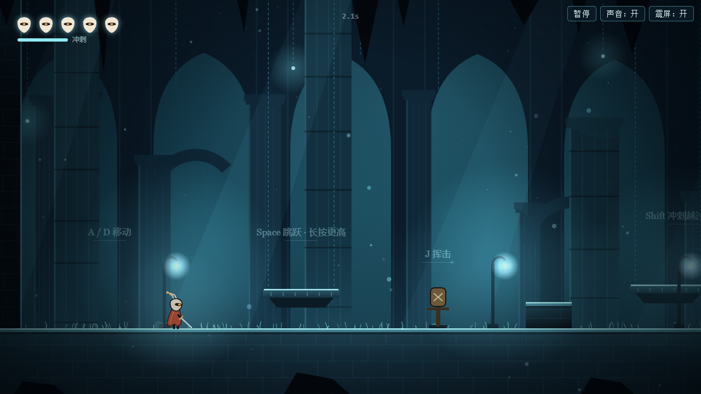
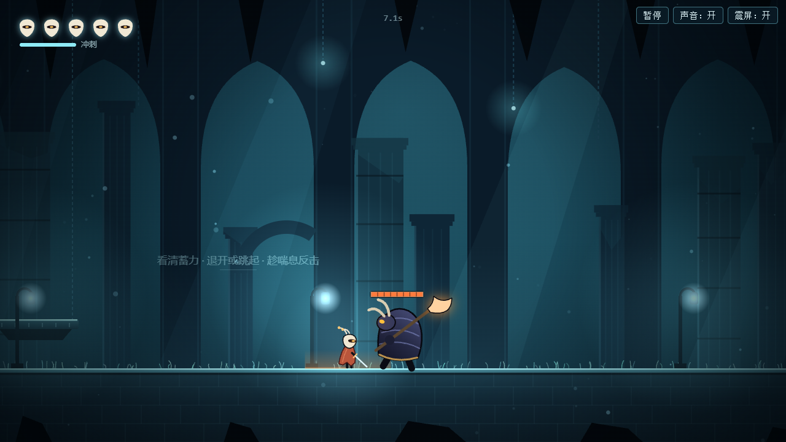
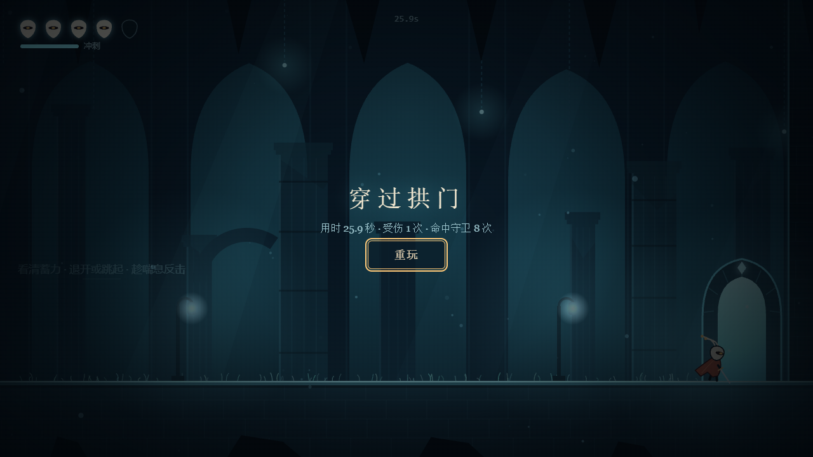

# 烬灯行者 · Hollow Knight-inspired prototype

《烬灯行者》是一个受 Team Cherry 的《空洞骑士》（Hollow Knight）启发的 2D 动作平台游戏原型。整个游戏是一个 HTML 文件，使用 Canvas 2D 绘制画面，使用 Web Audio API 合成音效，不依赖任何外部资源或第三方库。

**当前公开版本：[v0.2.0 多房间版](https://github.com/Ywan033/hollow-knight-repro/releases/tag/v0.2.0)**

v0.2.0 包含三个相连、可以往返的房间。点燃烬灯台后，倒下时会在灯旁复活；在守卫厅击败守卫、走进尽头的拱门即可通关。

本项目是个人的非官方实验，与 Team Cherry 没有关联，不包含原作的任何素材。

## 当前功能

当前版本为 v0.2.0，包含三个相连、可以往返的房间：

- **入口回廊**：练习移动、跳跃和挥击，越过一处荆棘坑。
- **烬灯庭**：两只来回爬行的锈壳虫、高台上的烬灯台，以及一处带落脚石的宽荆棘坑。
- **守卫厅**：一名守卫和尽头的拱门。

玩法：

- **移动**：左右移动、可变高度跳跃、带冷却的水平冲刺（空中限一次）。
- **战斗**：近身挥击。锈壳虫碰到身体会造成伤害，两次命中可以击倒；守卫会巡逻，发现玩家后蓄力并攻击，蓄力时地面显示预警区域。
- **烬灯台**：点燃后回满生命并成为重生点，之后可以再次在灯旁休息。
- **生命与重生**：生命值、受击后的短暂无敌、落入荆棘后回到最近的安全落点。倒下后在最近点燃的烬灯台旁醒来，没有点燃时回到入口；已取得的进度保留。
- **房间状态**：重新进入房间时锈壳虫会再次出现，未击败的守卫恢复满血；守卫被击败后不再出现，拱门保持开启。
- **流程**：标题、暂停、倒下和通关界面；击败守卫后拱门开启，通关时显示用时等统计。暂停菜单中的“重新开始”会清除本局全部进度。
- **音画**：角色、场景和音效均由程序绘制与合成；支持静音和调试显示。

## v0.1.0 历史截图

*以下截图均来自 v0.1.0 单房间版，尚未更新，不包含 v0.2.0 新增的房间、敌人和烬灯台。*



| 守卫蓄力预警（v0.1.0 截图） | 通关结算（v0.1.0 截图） |
| --- | --- |
|  |  |

## 本地运行

需要 Node.js。在 Windows 上，于仓库根目录执行：

```powershell
scripts\play.cmd
```

脚本会启动一个只监听 127.0.0.1 的本地服务，并用默认浏览器打开游戏；按 Ctrl+C 停止。在其他系统上运行 `node scripts/serve.mjs`，然后在浏览器中打开它输出的地址。

### 操作

| 按键 | 作用 |
| --- | --- |
| A / D 或 ← / → | 移动 |
| Space | 跳跃，短按低跳，长按高跳 |
| Shift | 冲刺 |
| J | 挥击 |
| E 或 ↑ | 在烬灯台旁点燃或休息 |
| Esc | 暂停 / 继续 |
| M | 静音 |
| F3 | 显示碰撞框和调试信息 |

目标：穿过入口回廊和烬灯庭，在守卫厅击败守卫，走进尽头的拱门。

## 验证概况

v0.2.0 的发布文件于 2026-11-13 在作者的环境（Windows 11，无头模式的 Chrome）中通过了 45 项自动行为检查，其中包含一次由脚本发送按键、穿过三个房间的完整通关。作者此前做过一次人工试玩并表示通过；试玩早于发布文件中一行代码注释的改动，没有留下逐项记录。自动通关依赖游戏的内部状态来决定按键时机。性能和其他浏览器中的表现尚未验证。详见 [docs/testing.md](docs/testing.md)。

## 当前限制

已知缺陷：

- 目前没有已确认但尚未修复的缺陷。v0.1.0 中“同时按住同一方向的两个键后松开其中一个，角色会停止移动”的问题已在 v0.2.0 修复。未做专门检查的情况见 [docs/testing.md](docs/testing.md)。

设计范围内的限制：

- 只有三个房间和两种敌人。
- 烬灯台和通关进度只在当前页面中保留，刷新或关闭页面后重新开始。
- 守卫只有一种攻击，蓄力过程不会被玩家的攻击打断。
- 玩家离开守卫的视野后，守卫会返回巡逻。
- 画布以 1280×720 渲染后缩放，在大屏或高分辨率屏幕上画面略软。

版本记录见 [CHANGELOG.md](CHANGELOG.md)。

## 开发背景

- v0.1.0 的游戏代码由 Claude Fable 5.2（`claude-fable-5-2`）通过 Claude Code 在一次无人值守的运行中生成，模型在运行中自行编写并执行了行为检查。之后由作者试玩确认。
- v0.2.0 在 v0.1.0 的基础上，由 Claude Code 在交互式会话中修改，自动检查同样由它编写和执行。之后由作者试玩确认。
- 三个房间的布局为本项目自行设计，不是原作地图的复现。
- 工作流参考了 [wquguru/fable52-fps-repro](https://github.com/wquguru/fable52-fps-repro)，未使用其代码、数据或文字。
- 玩法灵感来自 Team Cherry 的《空洞骑士》（Hollow Knight）。

本仓库目前未授予任何许可。
